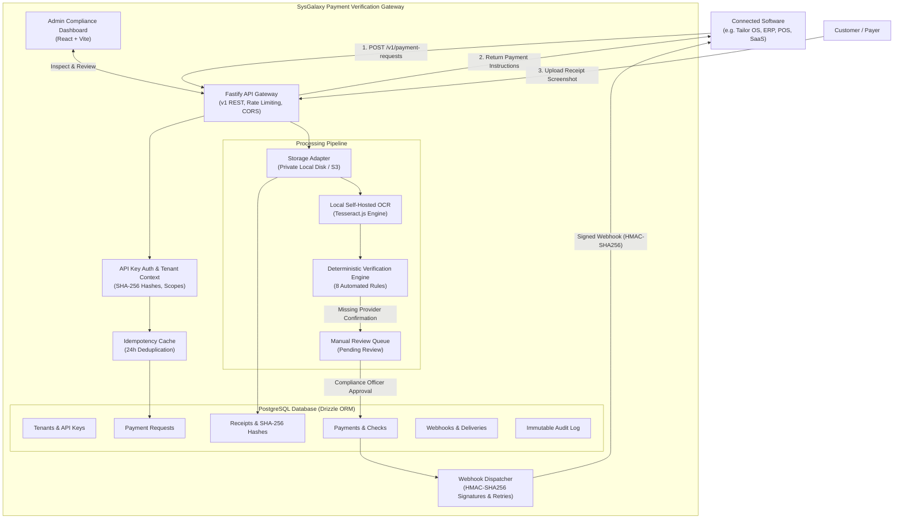
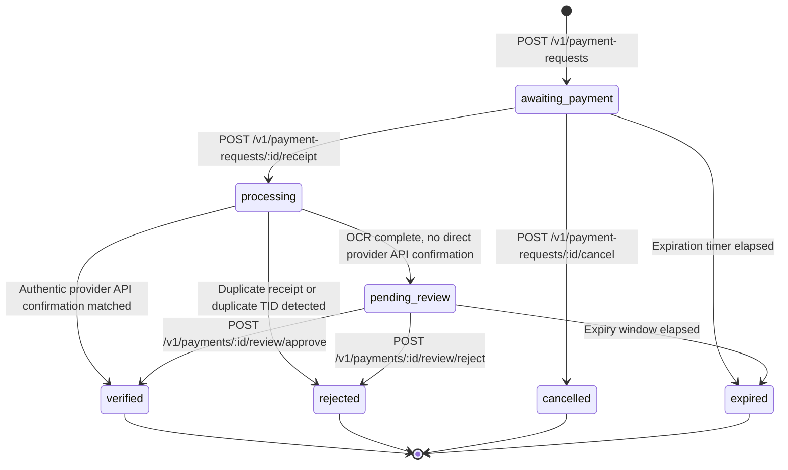

# SysGalaxy Payment Verification Gateway — Architecture Guide

This document describes the architectural design, security boundaries, multi-tenant data isolation, verification pipeline, and state machines of **SysGalaxy Payment Verification Gateway**.

---

## 1. High-Level System Architecture



---

## 2. Multi-Tenant Architecture & Data Isolation

SysGalaxy is designed for multi-tenant SaaS environments where dozens or hundreds of independent merchants operate on the same gateway instance.

### Strict Isolation Rules
1. **Foreign Key Scoping**: Every tenant-associated entity (`payment_requests`, `receipts`, `payments`, `api_keys`, `webhook_endpoints`, `audit_events`, `idempotency_records`) has a non-nullable `tenant_id` foreign key referencing `tenants(id)`.
2. **Database Query Scoping**: Every SQL query executed in API handlers is strictly filtered with `WHERE tenant_id = ${request.tenant.id}`.
3. **No Cross-Tenant Leaks**: Attempting to query an ID belonging to another tenant returns a `404 Not Found` rather than a `403 Forbidden`, preventing resource enumeration attacks.
4. **Environment Separation**: API keys and payment requests are segmented into `test` and `live` environments. Test requests do not affect live accounting or analytics.

---

## 3. Payment State Machine



### State Definitions
- `awaiting_payment`: Request created; customer has been shown payment instructions.
- `processing`: Receipt uploaded; storage and OCR analysis running.
- `pending_review`: Receipt and OCR parsed; waiting for human compliance reviewer to approve or reject.
- `verified`: Funds confirmed received (via `provider_verified` or `manual_verified`).
- `rejected`: Transaction rejected due to fraud, duplication, or lack of payment.
- `expired`: Customer did not submit receipt before expiry window.
- `cancelled`: Request explicitly cancelled by integrating software.

---

## 4. Deterministic Verification Engine Architecture

The Verification Engine (`VerificationEngine.evaluate`) executes 8 discrete, auditable checks in TypeScript:

1. **`EXPIRY_CHECK`**: Validates $now \le expires\_at$.
2. **`RECEIPT_HASH_UNIQUE`**: Computes SHA-256 of uploaded image buffer; queries DB for existing receipt with identical hash.
3. **`TXN_REF_UNIQUE`**: Queries existing payments to ensure the transaction reference has not been used previously.
4. **`AMOUNT_MATCH`**: Exact match comparison between requested paisa and evidence paisa.
5. **`CURRENCY_MATCH`**: Checks currency code (PKR).
6. **`RECEIVER_ACCOUNT_MATCH`**: Verifies receiver account matches merchant configured destination account.
7. **`DATE_PLAUSIBLE`**: Checks that payment slip date is within acceptable range (not in future, not older than 7 days).
8. **`TRUSTED_PROVIDER_EVIDENCE`**:
   > **Core Security Invariant**: Untrusted OCR extraction alone NEVER transitions a payment to `verified`. In the absence of an authenticated enterprise provider API or 1Link Host-to-Host statement, the engine defaults to `pending_review`.

Every check result is persisted in the `verification_checks` table with a timestamp and JSON details.

---

## 5. Storage Subsystem

SysGalaxy decouples file persistence through the `StorageAdapter` interface:

```typescript
export interface StorageAdapter {
  saveFile(originalFilename: string, buffer: Buffer, mimeType: string): Promise<SavedFileResult>;
  getFile(storagePath: string): Promise<Buffer>;
  deleteFile(storagePath: string): Promise<void>;
}
```

- **`LocalDiskStorageAdapter`**: Default implementation. Saves files into private storage (`./storage/uploads`) using random UUID-based filenames (e.g. `rec_a8f9b...png`). Files are stored with non-executable permissions (`0600`) outside the web root. Path traversal checks (`resolved.startsWith(baseDir)`) prevent unauthorized file reads.
- **`S3StorageAdapter`**: Extensible adapter interface for AWS S3, Google Cloud Storage, or MinIO.

---

## 6. Provider Adapter Architecture

To support future official integrations without fabricating fake provider endpoints, SysGalaxy implements a clean adapter registry:

```typescript
export interface PaymentProviderAdapter {
  readonly providerCode: string;
  readonly name: string;
  isOfficialConfigured(): boolean;
  verifyEvidence(txnRef: string, amountPaisa: number, currency: string): Promise<ProviderVerificationResult>;
}
```

- **Easypaisa Adapter**: Discloses missing official Telenor Microfinance Bank credentials; defaults to manual review.
- **JazzCash Adapter**: Discloses missing official Mobilink Microfinance Bank credentials; defaults to manual review.
- **Bank Transfer Adapter**: Discloses missing 1Link / Raast Host-to-Host credentials; defaults to manual review.
- **Mock Test Adapter**: Dedicated test adapter strictly for automated unit tests (`isMock: true`).
