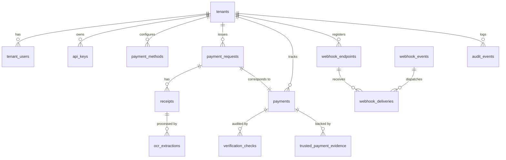

# SysGalaxy Payment Verification Gateway — Database Schema Documentation

This document describes the relational database schema, tables, relationships, indexes, constraints, and migration procedures for **SysGalaxy Payment Verification Gateway**.

---

## 1. Schema Overview

SysGalaxy uses PostgreSQL with **15 normalized tables** managed via **Drizzle ORM**.

---

## 2. Table Specifications

### 2.1 `tenants`
Stores independent merchant accounts.
| Column | Type | Constraints | Description |
| :--- | :--- | :--- | :--- |
| `id` | UUID | PRIMARY KEY, DEFAULT gen_random_uuid() | Unique tenant identifier |
| `name` | TEXT | NOT NULL | Business name (e.g. Tailor OS Merchant) |
| `slug` | TEXT | NOT NULL, UNIQUE | URL-safe slug |
| `status` | TEXT | NOT NULL, DEFAULT 'active' | `'active'` or `'suspended'` |
| `created_at` | TIMESTAMPTZ | NOT NULL, DEFAULT NOW() | Creation timestamp |
| `updated_at` | TIMESTAMPTZ | NOT NULL, DEFAULT NOW() | Last update timestamp |

---

### 2.2 `api_keys`
Stores cryptographic hashes of merchant API keys.
| Column | Type | Constraints | Description |
| :--- | :--- | :--- | :--- |
| `id` | UUID | PRIMARY KEY | Unique key record ID |
| `tenant_id` | UUID | NOT NULL, REFERENCES tenants(id) | Tenant owner |
| `key_hash` | TEXT | NOT NULL, UNIQUE | SHA-256 hex digest of secret key |
| `key_prefix` | TEXT | NOT NULL | Key prefix (e.g. `sg_test_7f9a2e`) |
| `label` | TEXT | NOT NULL | Friendly label (e.g. Production Key) |
| `environment` | TEXT | NOT NULL, DEFAULT 'test' | `'test'` or `'live'` |
| `scopes` | JSONB | NOT NULL, DEFAULT '["*"]' | Array of permitted scopes |
| `is_revoked` | BOOLEAN | NOT NULL, DEFAULT FALSE | Revocation status |
| `revoked_at` | TIMESTAMPTZ | NULL | Revocation timestamp |
| `last_used_at`| TIMESTAMPTZ | NULL | Last authenticated request time |

---

### 2.3 `payment_methods`
Tenant-configured payment destination instructions.
| Column | Type | Constraints | Description |
| :--- | :--- | :--- | :--- |
| `id` | UUID | PRIMARY KEY | Unique method record ID |
| `tenant_id` | UUID | NOT NULL, REFERENCES tenants(id) | Tenant owner |
| `code` | TEXT | NOT NULL | Code: `easypaisa`, `jazzcash`, `bank_transfer` |
| `name` | TEXT | NOT NULL | Display name (e.g. JazzCash Mobile Wallet) |
| `account_title` | TEXT | NOT NULL | Merchant recipient title |
| `account_identifier` | TEXT | NOT NULL | Mobile number or IBAN |
| `bank_name` | TEXT | NULL | Bank name for bank transfers |
| `instructions` | TEXT | NOT NULL | Step-by-step instructions shown to customer |
| `is_active` | BOOLEAN | NOT NULL, DEFAULT TRUE | Enable/disable method |
| `min_amount_paisa` | BIGINT | NOT NULL, DEFAULT 100 | Minimum transaction limit in paisa |
| `max_amount_paisa` | BIGINT | NOT NULL, DEFAULT 100000000 | Maximum transaction limit in paisa |
| **Constraint** | UNIQUE(tenant_id, code) | Unique payment method per tenant |

---

### 2.4 `payment_requests`
Inbound payment requests initiated by client software.
| Column | Type | Constraints | Description |
| :--- | :--- | :--- | :--- |
| `id` | UUID | PRIMARY KEY | Unique request ID |
| `tenant_id` | UUID | NOT NULL, REFERENCES tenants(id) | Tenant owner |
| `request_reference`| TEXT | NOT NULL, UNIQUE | Public reference (e.g. `pr_test_...`) |
| `order_reference` | TEXT | NOT NULL | Merchant's internal order ID |
| `amount_paisa` | BIGINT | NOT NULL | Expected amount in integer paisa |
| `currency` | TEXT | NOT NULL, DEFAULT 'PKR' | Currency (PKR) |
| `payment_method_code` | TEXT | NOT NULL | Selected payment method |
| `customer_name` | TEXT | NULL | Payer name |
| `customer_email` | TEXT | NULL | Payer email |
| `customer_phone` | TEXT | NULL | Payer phone |
| `status` | TEXT | NOT NULL, DEFAULT 'awaiting_payment' | Current state |
| `verification_method` | TEXT | NULL | `'provider_verified'` or `'manual_verified'` |
| `expires_at` | TIMESTAMPTZ | NOT NULL | Expiration timestamp |
| `cancelled_at` | TIMESTAMPTZ | NULL | Cancellation timestamp |
| `metadata` | JSONB | DEFAULT '{}' | Custom metadata |

---

### 2.5 `receipts`
Customer-uploaded payment slips and screenshots.
| Column | Type | Constraints | Description |
| :--- | :--- | :--- | :--- |
| `id` | UUID | PRIMARY KEY | Unique receipt ID |
| `payment_request_id` | UUID | NOT NULL, REFERENCES payment_requests(id) | Associated payment request |
| `tenant_id` | UUID | NOT NULL, REFERENCES tenants(id) | Tenant owner |
| `original_filename` | TEXT | NOT NULL | Original uploaded filename |
| `storage_path` | TEXT | NOT NULL | Private server-side storage path |
| `mime_type` | TEXT | NOT NULL | Verified MIME type (`image/png`, `image/jpeg`, etc.) |
| `file_size_bytes` | INTEGER | NOT NULL | File size in bytes |
| `sha256_hash` | TEXT | NOT NULL | SHA-256 digest of file buffer |
| `upload_ip` | TEXT | NULL | Client IP address |

---

### 2.6 `ocr_extractions`
Untrusted extraction results from local Tesseract.js engine.
| Column | Type | Constraints | Description |
| :--- | :--- | :--- | :--- |
| `id` | UUID | PRIMARY KEY | Extraction record ID |
| `receipt_id` | UUID | NOT NULL, REFERENCES receipts(id) | Associated receipt |
| `payment_request_id` | UUID | NOT NULL, REFERENCES payment_requests(id) | Associated payment request |
| `tenant_id` | UUID | NOT NULL, REFERENCES tenants(id) | Tenant owner |
| `raw_text` | TEXT | NOT NULL | Full OCR raw text |
| `confidence_score` | REAL | NOT NULL, DEFAULT 0 | Tesseract recognition confidence (0-100) |
| `detected_provider` | TEXT | NULL | Detected provider (easypaisa/jazzcash/bank) |
| `extracted_amount_paisa` | BIGINT | NULL | Parsed amount in paisa |
| `extracted_currency` | TEXT | NULL | Parsed currency code |
| `extracted_transaction_id` | TEXT | NULL | Parsed transaction ID / TID |
| `extracted_date_time` | TEXT | NULL | Parsed date and time string |
| `extracted_sender_account`| TEXT | NULL | Parsed sender account |
| `extracted_receiver_account`| TEXT | NULL | Parsed receiver account |
| `status` | TEXT | NOT NULL, DEFAULT 'completed' | `'completed'`, `'low_confidence'`, `'failed'` |
| `extraction_notes` | JSONB | DEFAULT '{}' | Extraction metadata & untrusted warning |

---

### 2.7 `payments`
Core transaction verification records.
| Column | Type | Constraints | Description |
| :--- | :--- | :--- | :--- |
| `id` | UUID | PRIMARY KEY | Unique payment ID |
| `payment_request_id` | UUID | NOT NULL, UNIQUE, REFERENCES payment_requests(id) | 1:1 with payment request |
| `tenant_id` | UUID | NOT NULL, REFERENCES tenants(id) | Tenant owner |
| `receipt_id` | UUID | NULL, REFERENCES receipts(id) | Linked receipt proof |
| `ocr_extraction_id` | UUID | NULL, REFERENCES ocr_extractions(id) | Linked OCR record |
| `status` | TEXT | NOT NULL, DEFAULT 'awaiting_payment' | Payment verification status |
| `verification_method` | TEXT | NULL | `'provider_verified'`, `'manual_verified'`, or `null` |
| `amount_paisa` | BIGINT | NOT NULL | Amount in paisa |
| `currency` | TEXT | NOT NULL, DEFAULT 'PKR' | Currency code |
| `transaction_reference` | TEXT | NULL | Settled transaction ID |
| `rejection_reason` | TEXT | NULL | Explanation if rejected |
| `manual_review_notes` | TEXT | NULL | Required notes if manually approved |
| `manual_reviewed_by` | TEXT | NULL | Compliance reviewer identifier |
| `verified_at` | TIMESTAMPTZ | NULL | Timestamp when verified |
| `rejected_at` | TIMESTAMPTZ | NULL | Timestamp when rejected |

---

### 2.8 `trusted_payment_evidence`
Direct evidence backing a verification.
| Column | Type | Constraints | Description |
| :--- | :--- | :--- | :--- |
| `id` | UUID | PRIMARY KEY | Evidence record ID |
| `payment_id` | UUID | REFERENCES payments(id) | Associated payment |
| `tenant_id` | UUID | NOT NULL, REFERENCES tenants(id) | Tenant owner |
| `provider_code` | TEXT | NOT NULL | Provider code |
| `provider_transaction_id` | TEXT | NOT NULL | Authenticated transaction ID |
| `evidence_type` | TEXT | NOT NULL | `'api_callback'`, `'statement_reconciliation'`, or `'authorized_manual_entry'` |
| `amount_paisa` | BIGINT | NOT NULL | Verified amount in paisa |
| `is_mock` | BOOLEAN | NOT NULL, DEFAULT FALSE | Explicit test harness flag |

---

### 2.9 `verification_checks`
Audit log of individual deterministic rules evaluated.
| Column | Type | Constraints | Description |
| :--- | :--- | :--- | :--- |
| `id` | UUID | PRIMARY KEY | Check ID |
| `payment_id` | UUID | NOT NULL, REFERENCES payments(id) | Associated payment |
| `tenant_id` | UUID | NOT NULL, REFERENCES tenants(id) | Tenant owner |
| `check_name` | TEXT | NOT NULL | e.g. `AMOUNT_MATCH`, `RECEIPT_HASH_UNIQUE` |
| `passed` | BOOLEAN | NOT NULL | Check passed or failed |
| `details` | JSONB | DEFAULT '{}' | Diagnostic details |

---

### 2.10 `webhook_endpoints`, `webhook_events`, `webhook_deliveries`
Signed webhook dispatching and retry tracking tables.

### 2.11 `idempotency_records`
Prevents duplicate request execution by caching responses for 24 hours under `(tenant_id, idempotency_key)`.

### 2.12 `audit_events`
Immutable record of all administrative and API actions for security audits.

---

## 3. Database Indexes

- `idx_payment_requests_tenant`: `payment_requests(tenant_id)`
- `idx_payment_requests_order_ref`: `payment_requests(tenant_id, order_reference)`
- `idx_receipts_hash`: `receipts(sha256_hash)`
- `idx_payments_tenant_txn`: `payments(tenant_id, transaction_reference)`
- `idx_payments_status`: `payments(status)`
- `idx_audit_events_tenant`: `audit_events(tenant_id)`
- `idx_idempotency_tenant_key`: `idempotency_records(tenant_id, idempotency_key)`
