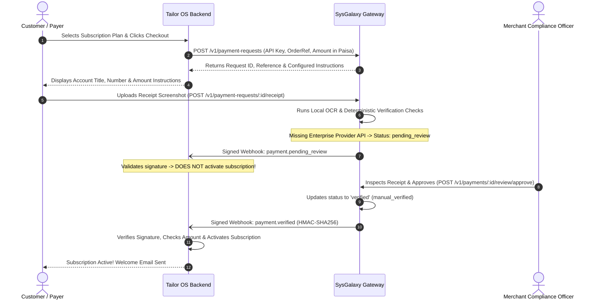

# Tailor OS & Third-Party Integration Guide

This guide describes how **Tailor OS** (and other third-party SaaS/ERP/e-commerce platforms) integrates with **SysGalaxy Payment Verification Gateway**.

---

## 1. Integration Journey Overview

The complete lifecycle consists of 9 coordinated steps:



---

## 2. Step-by-Step Implementation for Tailor OS

### Step 1: Create Payment Request
When a tailor shop owner upgrades their subscription in Tailor OS, the Tailor OS backend calls SysGalaxy:

```typescript
// tailor-os-billing.ts (Tailor OS Backend)
const GATEWAY_URL = process.env.SYSGALAXY_API_URL || 'https://api.sysgalaxy.io';
const GATEWAY_KEY = process.env.SYSGALAXY_API_KEY; // Never expose to browser!

export async function createTailorSubscriptionPayment(orderId: string, amountRupees: number) {
  const response = await fetch(`${GATEWAY_URL}/v1/payment-requests`, {
    method: 'POST',
    headers: {
      'Content-Type': 'application/json',
      Authorization: `Bearer ${GATEWAY_KEY}`,
      'Idempotency-Key': `tailor_order_${orderId}`,
    },
    body: JSON.stringify({
      order_reference: orderId,
      amount: amountRupees, // or amount_paisa: amountRupees * 100
      currency: 'PKR',
      payment_method_code: 'jazzcash',
      customer_name: 'Ahmad Fine Tailors',
      customer_email: 'ahmad@example.com',
      expires_in_minutes: 120,
      metadata: {
        system: 'Tailor OS',
        plan: 'Master Tailor Annual',
      },
    }),
  });

  const data = await response.json();
  return data; // Returns instructions for the frontend
}
```

---

### Step 2: Show Instructions to Customer
Tailor OS displays the gateway instructions:
- **Payment Method**: JazzCash Account
- **Account Title**: `Tailor OS Payments`
- **Account Identifier**: `03000000000`
- **Exact Amount**: `PKR 4,500.00`
- **Gateway Reference**: `pr_live_...`
- **Step-by-step**: `"Transfer via JazzCash mobile app to account 03000000000. Keep the transaction SMS and screenshot."`

---

### Step 3: Customer Uploads Receipt Proof
The customer makes the transfer and uploads their receipt screenshot directly to the gateway endpoint:
`POST /v1/payment-requests/:id/receipt`

---

### Step 4 & 5: Gateway Evaluates & Dispatches Signed Webhook
SysGalaxy processes local Tesseract.js OCR and evaluates deterministic checks:
- Since automated direct bank reconciliation is unconfigured, the transaction status transitions to `pending_review`.
- SysGalaxy signs and sends a `payment.pending_review` webhook event.

---

### Step 6, 7 & 8: Tailor OS Webhook Receiver

> **CRITICAL RULE**: Tailor OS must **never** activate a paid subscription while payment status is `pending_review`!

```typescript
// routes/webhooks.ts (Tailor OS Backend)
import crypto from 'node:crypto';
import type { Request, Response } from 'express';

const WEBHOOK_SECRET = process.env.SYSGALAXY_WEBHOOK_SECRET!;
const processedEvents = new Set<string>();

export async function handleSysGalaxyWebhook(req: Request, res: Response) {
  const signatureHeader = req.headers['x-sysgalaxy-signature'] as string;
  const rawPayload = req.body; // Ensure raw body string is preserved

  // 1. Verify HMAC-SHA256 signature
  const parts = Object.fromEntries(signatureHeader.split(',').map(p => p.split('=')));
  const timestamp = parseInt(parts.t, 10);
  const signature = parts.v1;

  // Replay protection (5 minutes tolerance)
  if (Math.abs(Math.floor(Date.now() / 1000) - timestamp) > 300) {
    return res.status(400).send('Signature timestamp out of range');
  }

  const expectedSignature = crypto
    .createHmac('sha256', WEBHOOK_SECRET)
    .update(`${timestamp}.${rawPayload}`)
    .digest('hex');

  if (!crypto.timingSafeEqual(Buffer.from(signature, 'hex'), Buffer.from(expectedSignature, 'hex'))) {
    return res.status(401).send('Invalid signature');
  }

  const event = JSON.parse(rawPayload);

  // 2. Idempotency Check: Prevent duplicate activations
  if (processedEvents.has(event.id)) {
    return res.status(200).json({ status: 'duplicate_ignored' });
  }

  // 3. Look up order in Tailor OS database
  const order = await getTailorOrder(event.orderReference);
  if (!order) {
    return res.status(404).send('Order not found');
  }

  // 4. Parity check: Verify amount and currency match
  if (order.amountPaisa !== event.amountPaisa || order.currency !== event.currency) {
    return res.status(400).send('Amount mismatch');
  }

  // 5. Handling Pending Review
  if (event.status === 'pending_review') {
    await updateOrderStatus(order.id, 'awaiting_merchant_approval');
    processedEvents.add(event.id);
    return res.status(200).json({ status: 'acknowledged' });
  }

  // 6. Subscription Activation ONLY on Verified Status
  if (event.status === 'verified') {
    await activateTailorSubscription({
      orderId: order.id,
      shopId: order.shopId,
      verificationMethod: event.verificationMethod, // 'provider_verified' or 'manual_verified'
      activatedAt: new Date(),
    });
    processedEvents.add(event.id);
    return res.status(200).json({ status: 'subscription_activated' });
  }

  res.status(200).json({ status: 'unhandled_event' });
}
```

---

## 3. Generic Third-Party Integration (ERP, POS, E-Commerce)

Any software system can integrate with SysGalaxy using standard REST calls and webhooks without any Tailor OS specific dependencies.

### Configuration Checklist for Any Software
1. Register a merchant tenant account in SysGalaxy.
2. Configure active payment methods (Easypaisa, JazzCash, Meezan Bank IBAN).
3. Generate an API Key (`sg_live_...`) and store it securely in your backend environment variables.
4. Register a Webhook Endpoint URL (`https://your-domain.com/webhooks/sysgalaxy`) and copy the generated secret key.
5. In your checkout flow, make a `POST /v1/payment-requests` call and render the returned `instructions` to your user.
6. Verify incoming webhook HMAC signatures and activate your digital orders upon `payment.verified`.
